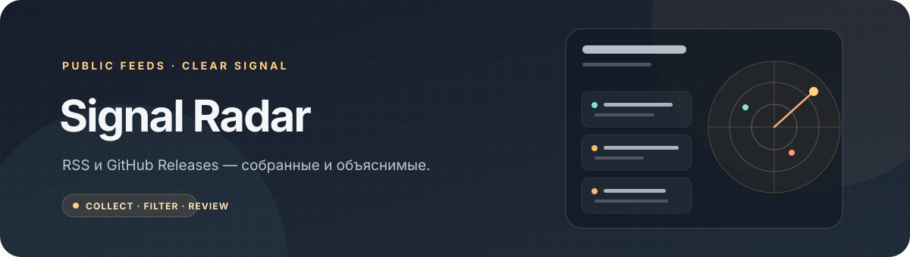
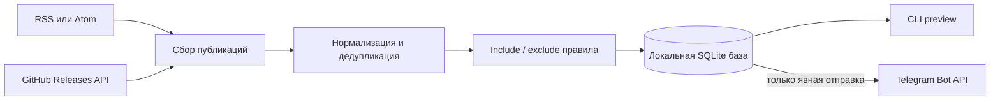

# Signal Radar



Локальный монитор RSS/Atom лент и публичных GitHub Releases. Он нормализует и дедуплицирует публикации, применяет объяснимые keyword-правила и хранит состояние в SQLite.

[](https://github.com/jezannn16/signal-radar/actions/workflows/ci.yml)

**Навигация:** [Как работает](#как-работает) · [Установка и первый запуск](#установка-и-первый-запуск) · [Telegram дайджест](#telegram-дайджест) · [Проверки](#проверки) · [Безопасность и ограничения](#безопасность-и-ограничения)

## Как работает



- Источники добавляются отдельно; ошибка одной ленты не мешает обработке остальных.
- GitHub читается через публичный REST endpoint Releases, с поддержкой Link pagination. Токен необязателен и нужен только при необходимости дополнительного лимита API.
- URL нормализуются с удалением типичных tracking-параметров. Изменения публикации сохраняются в `item_versions`.
- RSS conditional GET сохраняет `ETag` и `Last-Modified` на источник и отправляет `If-None-Match`/`If-Modified-Since`; ответ 304 обновляет время проверки без повторного разбора и вставки элементов.
- Include/exclude правила дают объяснение выбранному элементу через `why ID`.
- Перед отправкой Telegram можно посмотреть очередь командой `digest`; для отправки необходим явный `digest --send`.

## Установка и первый запуск

Нужны Python 3.11+ и [uv](https://docs.astral.sh/uv/).

```sh
uv sync --extra dev
uv run signal-radar --help
uv run signal-radar add-source rss Hacker-News https://hnrss.org/frontpage
uv run signal-radar add-source github click-releases pallets/click
uv run signal-radar rule include security
uv run signal-radar add-source rss vendor https://vendor.example/releases --topic releases
uv run signal-radar rule exclude preview --topic releases
uv run signal-radar rule include api --source vendor
uv run signal-radar collect
uv run signal-radar items
uv run signal-radar why 1
```

Для GitHub добавляйте публичный репозиторий в формате `owner/repo`. По умолчанию используется `signal_radar.sqlite3` в текущей папке. Можно задать другой путь через `--db PATH` перед подкомандой. Повторный `collect` обновляет checkpoint и не создаёт копию неизменившейся публикации.

## Telegram дайджест

Установите опциональную зависимость и задайте локально `TELEGRAM_BOT_TOKEN` и `TELEGRAM_CHAT_ID` в `.env`:

```sh
uv sync --extra dev --extra telegram
uv run signal-radar digest
uv run signal-radar digest --send
```

`digest` только показывает preview. `digest --send` отправляет реальные сообщения в указанный чат. Для расписания можно использовать `run --interval 900` и настройки `DIGEST_CADENCE`, `DIGEST_TIMEZONE`, `DIGEST_HOUR`, `QUIET_HOURS_START`, `QUIET_HOURS_END`. Если время отправки пропущено из-за простоя, digest может догнать слот позже в том же дне/неделе после завершения тихих часов. Планировщик запускайте только после настройки приватного тестового чата.

Правила без scope применяются глобально; `--source` ограничивает правило именем настроенного источника, а `--topic` — меткой, заданной через `add-source --topic`. Дайджест группирует одинаковые canonical URL из разных источников, но сохраняет исходные записи и показывает все имена источников. Если Telegram отправка оборвалась при неизвестном результате, зависшая запись после 10 минут становится `unknown` и автоматически не отправляется повторно: сначала проверьте чат вручную.

## Проверки

```sh
uv run pytest
uv run ruff check src tests
```

По умолчанию API тесты используют подменённый HTTP транспорт. Опционально можно сделать read-only запросы к публичной RSS ленте Hacker News и публичному GitHub Releases API, используя временную SQLite базу:

```sh
RUN_LIVE_TESTS=1 uv run pytest -m live
```

Live сценарий ничего не публикует и не отправляет в Telegram. GitHub Actions выполняет unit-тесты и Ruff на Python 3.11 и 3.12; live тесты запускаются только вручную.

## Безопасность и ограничения

Токены и `.env` не коммитьте. Не добавляйте credentials в RSS URL: adapter отклоняет user/password в URL, а ошибки не сохраняют URL и параметры запроса. SQLite база и существующие sidecar-файлы создаются с правами владельца (`0600`). RSS и GitHub content являются внешними данными; Signal Radar показывает заголовок, причину и исходную ссылку, не исполняя содержимое.

Дайджест использует at-most-once доставку: неопределённый результат Telegram запроса не повторяется автоматически, чтобы не отправить дубль. GitHub адаптер читает Releases, не issues или commits. RSS conditional GET зависит от того, возвращает ли источник валидаторы. LLM-сводки и OAuth не реализованы.
